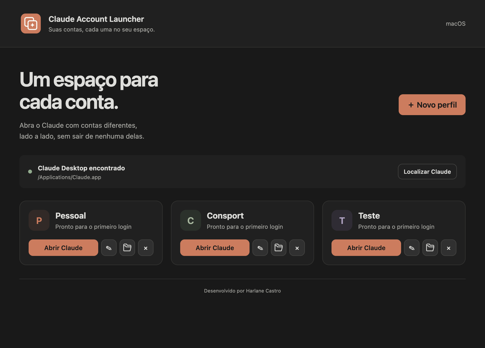

# Claude Account Launcher

Aplicativo Electron para macOS e Windows, desenvolvido por **Harlane Castro**, para abrir contas diferentes do Claude Desktop sem usar o terminal.



## Instalação

### macOS

1. Abra o arquivo `.dmg` correspondente ao seu Mac: **arm64** para Apple Silicon ou **x64** para Intel.
2. Arraste **Claude Account Launcher** para **Aplicativos**.
3. Abra o aplicativo na pasta Aplicativos uma vez para registrar a inicialização automática.

### Windows

1. Execute **Claude Account Launcher Setup** e conclua a instalação.
2. Abra o aplicativo uma vez para registrar a inicialização automática.

O Claude Desktop precisa estar instalado. Os instaladores locais e os gerados pelo workflow não têm assinatura digital nem notarização por padrão; a distribuição assinada depende dos certificados de desenvolvimento correspondentes.

## Perfis e contas

1. Clique em **Novo perfil**, informe um nome, como Pessoal ou Trabalho, e salve.
2. Clique em **Abrir Claude** e entre na conta desejada dentro da janela do Claude.
3. Repita o processo para as outras contas.

Cada perfil usa uma pasta de dados própria. O Launcher não pede nem armazena senhas; os dados de autenticação pertencem ao próprio Claude. O perfil padrão já existente no Claude não é importado automaticamente.

O aplicativo procura automaticamente o Claude nas instalações comuns do macOS e do Windows, incluindo pacotes da Microsoft Store. Se necessário, use **Localizar Claude** para selecionar `Claude.app` ou `Claude.exe`.

## Barra do macOS e bandeja do Windows

Clique no símbolo de duas janelas na barra superior do macOS ou na bandeja do Windows para:

- **Abrir aplicativo:** exibir a janela principal.
- **Abrir [nome do perfil]:** solicitar a abertura daquela instância do Claude sem exibir o Launcher.
- **Sair:** encerrar o Launcher.

O menu acompanha os perfis criados, renomeados e removidos. No Windows, o sistema pode colocar o ícone na área de ícones ocultos da bandeja; você pode fixá-lo pelas configurações da barra de tarefas.

Fechar ou minimizar a janela mantém o aplicativo na barra ou na bandeja. As janelas do Claude continuam funcionando independentemente do Launcher.

## Inicialização automática

Depois da primeira execução da versão instalada, o Launcher inicia automaticamente **ao entrar na sua sessão do sistema**, sem abrir a janela principal; apenas o ícone fica disponível na barra ou na bandeja.

- **macOS:** um agente do usuário em `~/Library/LaunchAgents/com.claudeaccountlauncher.desktop.plist` aponta para o aplicativo e usa o argumento `--background`; não exige acesso de administrador nem depende de `openAsHidden`, removido nas versões recentes do Electron.
- **Windows:** o aplicativo registra a própria inicialização pelo Electron, com o argumento `--background`, e verifica se a configuração foi ativada.

Mantenha o aplicativo instalado em um caminho permanente. Se o sistema ou uma política corporativa bloquear a execução em segundo plano, será necessário permiti-la nas configurações do sistema. A versão de desenvolvimento (`npm start`) não registra o runtime compartilhado do Electron na inicialização.

Para remover completamente a inicialização do macOS ao desinstalar, remova o arquivo de agente indicado acima; no Windows, desative **Claude Account Launcher** em **Configurações > Aplicativos > Inicialização** antes de desinstalar.

## Tamanho da janela

O aplicativo salva o tamanho e a posição da janela ao redimensionar, mover, fechar ou sair. Ao abrir novamente, recupera essas dimensões e o estado maximizado. Se um monitor for desconectado, a posição é ajustada para uma tela disponível.

## Dados locais

Os arquivos ficam na pasta de dados do usuário do aplicativo:

- macOS: `~/Library/Application Support/Claude Account Launcher/`
- Windows: `%APPDATA%/Claude Account Launcher/`

| Arquivo ou pasta | Conteúdo |
| --- | --- |
| `accounts.json` | Nomes, identificadores, última abertura e caminho do Claude |
| `window-state.json` | Dimensões, posição e estado maximizado da janela |
| `profiles/<identificador>/` | Dados e sessão do Claude para cada perfil |

**Remover perfil** retira a entrada da lista e preserva os arquivos e a sessão. A ação não fecha a janela do Claude nem exclui dados.

## Limitações do Claude Desktop

A abertura usa `--user-data-dir`; a compatibilidade e o isolamento efetivo dependem da versão instalada do Claude. O Launcher solicita a abertura, mas não confirma o login ou o funcionamento interno do Claude.

No Windows, o retorno de um login Google ou SSO pode alcançar outra instância. Quando disponível, use entrada por e-mail ou código na nova janela. Contas corporativas que exigem SSO continuam sujeitas às limitações do Claude Desktop.

## Desenvolvimento

Requer Node.js **22.12 ou superior** e npm.

```sh
npm ci
npm start
```

Para iniciar manualmente em segundo plano durante o desenvolvimento:

```sh
npm start -- --background
```

## Ícones

O símbolo representa duas janelas sobrepostas com um brilho na janela da frente, nas cores terracota (`#d97757`) e creme (`#faf9f5`).

O ícone da barra/bandeja é monocromático: branco no modo escuro e preto no modo claro, acompanhando alterações do tema do sistema sem reiniciar o app; no macOS, a adaptação usa o template nativo da barra de menus.

Os vetores editáveis ficam em `src/assets/icon.svg` e `src/assets/tray.svg`. As versões PNG, ICO e ICNS são incluídas no projeto para a janela, o Dock, a barra do macOS, a bandeja do Windows e os instaladores.

Para gerar os arquivos novamente após editar os vetores:

```sh
npm run icons
```

A geração de ICNS usa `iconutil` e deve ser feita em um Mac.

## Verificação

```sh
npm test
npm run test:ui
npm run test:desktop
```

Os testes verificam os argumentos de abertura do Claude nas duas plataformas, o registro da inicialização automática, a persistência de dimensões e a recuperação de uma janela fora da tela. Os testes no Electron verificam a interface, a ponte IPC, o início oculto, o menu nativo da barra/bandeja, a seleção de perfis, a atualização do menu, fechar para a bandeja e restaurar o tamanho após recriar a janela.

A execução real no Windows e o login em cada conta precisam ser validados no respectivo sistema. O teste de início em segundo plano verifica o comportamento do processo; não reinicia nem encerra a sessão do usuário.

## Gerar instaladores

```sh
npm run dist:mac
npm run dist:win
```

Os comandos geram pacotes **arm64 e x64** em `dist/`. A geração do macOS exige um Mac. É possível gerar o instalador Windows a partir de um Mac, mas a execução deve ser validada no Windows.

O workflow em `.github/workflows/build.yml` permite gerar os instaladores manualmente ou ao publicar tags `v*`.
